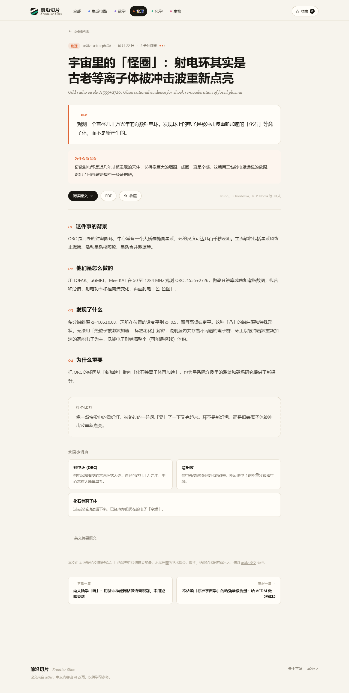

# 前沿切片 · Frontier Slice

给高中生看的科研速递。每天从 [arXiv](https://arxiv.org) 抓取集成电路、数学、物理、化学、生物的新论文，
用大模型翻成中文、拆成「背景 / 怎么做 / 发现了什么 / 为什么重要」，再配一个生活化的比喻和术语小词典。

目标不是替代论文，而是让你在 3 分钟里判断：**这篇论文跟我有没有关系，值不值得点开原文。**

**线上地址：<https://yiwenju.asia>**（Cloudflare Pages，项目名 `yiwenju`）




---

## 长什么样

- 首页：按时间排序的卡片流，带领域筛选、搜索、难度和阅读时长
- 详情页：一句话总结 → 为什么值得看 → 四段精读 → 打个比方 → 术语小词典 → 英文摘要原文
- 收藏：存在浏览器 localStorage，不需要登录
- 零依赖、纯静态：没有数据库，也没有后端

## 项目结构

```
frontier-slice/
├─ index.html              站点骨架
├─ 404.html                找不到页面时的兜底
├─ DEPLOY.md               上线与域名指南
├─ assets/
│  ├─ style.css            样式（暖纸底 + 学科色）
│  ├─ app.js               路由、渲染、搜索、收藏
│  └─ favicon.svg
├─ data/
│  ├─ fields.json          五个领域的定义（名称、颜色、arXiv 分类）
│  ├─ curation.json        中文改写（人工 + 模型生成）
│  ├─ meta.json            arXiv 元数据缓存
│  ├─ papers.json          站点真正读取的数据
│  └─ raw/                 抓取到的候选论文（不进 git）
├─ scripts/
│  ├─ fetch.mjs            抓取 arXiv 元数据
│  ├─ summarize.mjs        调大模型筛选 + 改写
│  ├─ compose.mjs          合并成 papers.json
│  ├─ build.mjs            生成可部署的 dist/
│  └─ serve.mjs            本地静态服务器
├─ dist/                   部署产物（build 生成，不进 git）
└─ .github/workflows/daily.yml   每天自动更新
```

## 本地预览

需要 Node.js 18+，不需要 `npm install`。

```bash
node scripts/serve.mjs
# 打开 http://127.0.0.1:4173
```

> 不要直接双击 `index.html`：浏览器会以 `file://` 打开，`fetch` 读不到 JSON。

## 每天自动更新

流程是三步：**抓取 → 改写 → 合成**。

```bash
# 1. 抓最近 7 天、每个领域 12 篇候选
node scripts/fetch.mjs --per-field 12 --days 7

# 2. 让模型挑 3 篇并写成中文（需要 API Key）
#    PowerShell:
$env:LLM_API_KEY="sk-..."
node scripts/summarize.mjs --per-field 3

# 3. 合成站点数据
node scripts/compose.mjs
```

也可以一条命令：

```bash
npm run refresh
```

### 配置模型

任何 OpenAI 兼容接口都可以，默认走 DeepSeek：

| 环境变量 | 说明 | 默认 |
| --- | --- | --- |
| `LLM_API_KEY` | 必填，也接受 `DEEPSEEK_API_KEY` | — |
| `LLM_BASE_URL` | 接口地址 | `https://api.deepseek.com` |
| `LLM_MODEL` | 模型名 | `deepseek-chat` |

想换成别的模型（Qwen、Kimi、GPT、Claude 的兼容网关）只改这两个变量即可。

### 放到 GitHub 上每天跑

1. 把仓库推到 GitHub
2. `Settings → Secrets and variables → Actions` 新建 `LLM_API_KEY`
3. `.github/workflows/daily.yml` 已配置好每天早上 7 点（北京时间）跑一次，也可以手动触发

### 部署

```bash
node scripts/build.mjs   # 生成 dist/，只包含站点文件
```

把 `dist/` 传到任意静态托管即可。完整的步骤（Cloudflare Pages / GitHub Pages / 域名与备案）见 **[DEPLOY.md](DEPLOY.md)**。

- **Cloudflare Pages**：拖拽 `dist/` 上传，绑定域名，自动 HTTPS（推荐）
- **GitHub Pages**：推到仓库，Settings → Pages 选 `main / root`
- **Vercel**：Framework 选 `Other`，Output 填 `dist`

## 改成你自己的领域

编辑 `data/fields.json`：

```json
{
  "id": "econ",
  "name": "经济学",
  "en": "Economics",
  "color": "#c8871a",
  "blurb": "市场、行为、政策，以及它们背后的数学",
  "arxiv": ["econ.GN", "econ.TH", "q-fin.GN"]
}
```

导航、筛选、颜色、抓取分类都会自动跟着变。

## 数据结构

`data/papers.json` 是前端唯一的输入：

```jsonc
{
  "generated_at": "2026-10-25T...",
  "count": 16,
  "papers": [
    {
      "id": "2610.27376",
      "field": "chip",
      "title_zh": "…",
      "title_en": "…",
      "one_liner": "…",
      "why": "…",
      "sections": { "background": "…", "method": "…", "finding": "…", "impact": "…" },
      "analogy": "…",
      "terms": [{ "t": "微环谐振器", "d": "…" }],
      "tags": ["光子芯片"],
      "difficulty": 3,
      "minutes": 4,
      "pick": true,
      "authors": ["…"],
      "abstract": "…",
      "url": "https://arxiv.org/abs/…",
      "pdf": "https://arxiv.org/pdf/…"
    }
  ]
}
```

`data/curation.json` 用同样的字段（`bg/method/finding/impact` 平铺），按 arXiv id 索引；
`compose.mjs` 负责把中文内容和 arXiv 元数据合并。

## 一点说明

- 中文内容全部由 AI 改写，会简化、会省略，也可能理解错。每篇都保留了原文链接。
- 抓取只取元数据和摘要，不下载 PDF，对 arXiv 比较友好（请求间隔 3 秒）。
- `data/raw/` 和 `data/meta.json` 可以删掉重新生成，`papers.json` 会随之重建。
- 站点的语气、篇幅、难度都可以在 `scripts/summarize.mjs` 的 `SYSTEM` 提示词里改。
